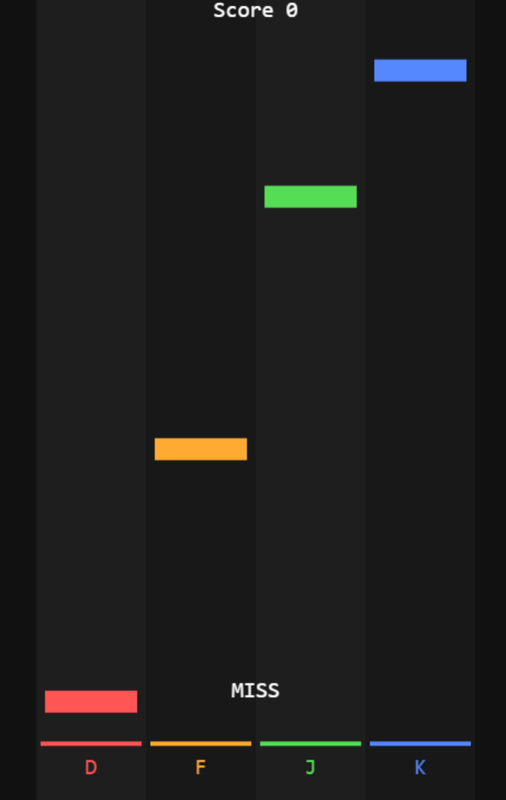
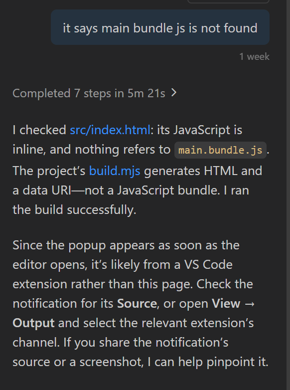

# Overview
This is a browser-based html program which allows you to play a 4 key rhythm game right on your browser without any download required or visiting any website, and the best part is that this program is only 2467 bytes! Using the 4 keys shown, the aim of the game is to tap the keys in sync with the visual cues to attain a high or perfect score. 

# How to Play
Press D, F, J or K when prompted to start the game. Press D, F, J or K according to the visual cues to increase your score as shown in the image below. Based on the accuracy of your input, you can get a Perfect, Good or a Miss.
 

# Tech Stack
HTML  
Visual Studio Code  
Module Javascript  

# AI Usage
I have used Copilot AI in this project to inquire about a popup I kept on getting saying main bundle.js was not found. After a bit of querying I found out it was irrelevant and that it was most likely from an extention rather than my program.
 
